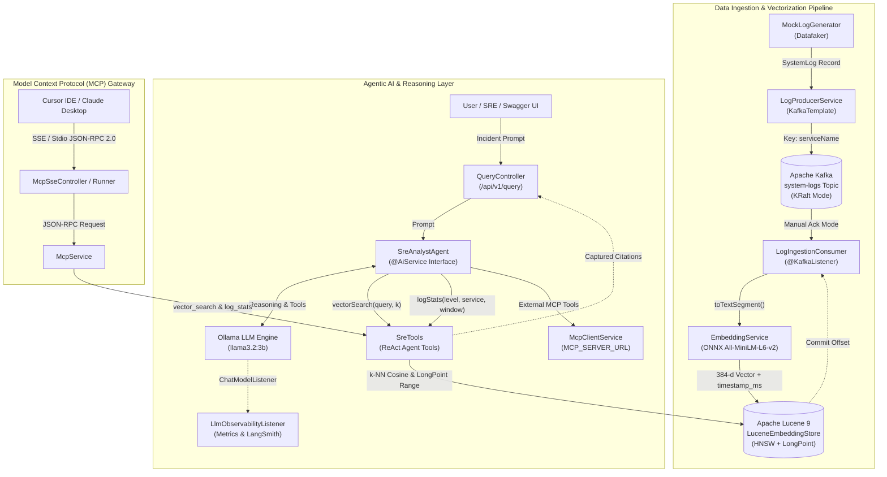
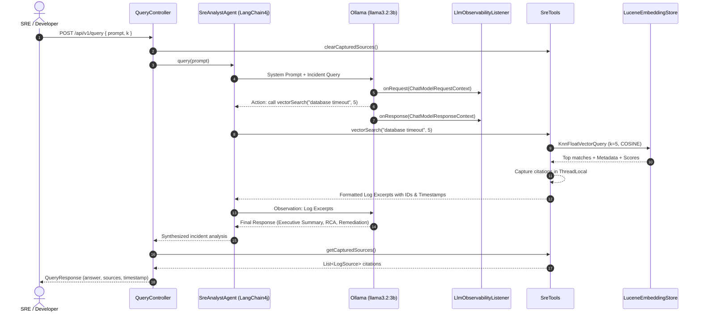

# Technical Architecture & System Guide: Enterprise Streaming RAG in Java

---

## 📋 Table of Contents
1. [High-Level Description & Scope](#1-high-level-description--scope)
   - [Problem Statement](#problem-statement)
   - [Solution & Value Proposition](#solution--value-proposition)
   - [Project Scope & Boundaries](#project-scope--boundaries)
   - [Why Java for Streaming RAG? (Enterprise Rationale)](#why-java-for-streaming-rag-enterprise-rationale)
   - [Dual-Repository Context (Java vs. Python)](#dual-repository-context-java-vs-python)
2. [End-to-End System Architecture](#2-end-to-end-system-architecture)
   - [High-Level Architectural Blueprint](#high-level-architectural-blueprint)
   - [Dataflow Sequence](#dataflow-sequence)
   - [Two-Tier Deployment Architecture](#two-tier-deployment-architecture)
3. [Deep-Dive Architectural Components & Layers](#3-deep-dive-architectural-components--layers)
   - [Layer 1: Data Generation & Ingestion Layer](#layer-1-data-generation--ingestion-layer)
   - [Layer 2: Stream Processing & Vector Pipeline Layer](#layer-2-stream-processing--vector-pipeline-layer)
   - [Layer 3: Embedded Vector Database Layer (Apache Lucene 9)](#layer-3-embedded-vector-database-layer-apache-lucene-9)
   - [Layer 4: Agentic AI & Autonomous Reasoning Layer](#layer-4-agentic-ai--autonomous-reasoning-layer)
   - [Layer 5: Interface & Tool Integration Layer (REST, Swagger UI, SSE & MCP)](#layer-5-interface--tool-integration-layer-rest-swagger-ui-sse--mcp)
4. [Summary of Architectural Decisions (ADRs)](#4-summary-of-architectural-decisions-adrs)
5. [Non-Functional Requirements & Resilience](#5-non-functional-requirements--resilience)
   - [At-Least-Once Delivery & Fault Tolerance](#at-least-once-delivery--fault-tolerance)
   - [Concurrency Model & Virtual Threads](#concurrency-model--virtual-threads)
   - [Data Provenance & Anti-Hallucination Guardrails](#data-provenance--anti-hallucination-guardrails)
6. [Cross-Reference & Further Reading](#6-cross-reference--further-reading)

---

## 1. High-Level Description & Scope

### Problem Statement
In enterprise microservice ecosystems, distributed applications generate massive streams of operational telemetry and structured log events. During critical production incidents (e.g., cascading payment timeouts, connection pool exhaustion, authentication anomalies):
- **Cognitive Overload:** Site Reliability Engineers (SREs) and on-call engineers are inundated with thousands of unstructured log lines across dozens of microservices.
- **Query Brittleness:** Traditional log aggregation platforms (e.g., Elasticsearch, Splunk) rely predominantly on exact lexical matching and manual dashboard filtering, failing when incident symptoms manifest under varied phrasing, unindexed error messages, or cross-service trace hops.
- **High Time-to-Mitigate (TTM):** Manual root-cause analysis (RCA) requires assembling error timelines, inspecting stack traces, and synthesizing blast radius under extreme time pressure.

### Solution & Value Proposition
**Enterprise Streaming RAG in Java** solves this problem by combining **real-time event-driven log streaming** with **in-process semantic vectorization** and an **autonomous agentic Site Reliability Engineering (SRE) assistant**.

Rather than querying a static database after an outage has escalated, the system indexes streaming logs in real time into an embedded vector store. An autonomous AI agent powered by **LangChain4j** and **Ollama** dynamically plans search strategies, executes semantic similarity lookups across Apache Lucene, inspects sliding time-windowed error distributions, invokes external MCP tools, and synthesizes structured incident reports with verifiable citations—all accessible via REST APIs, interactive Swagger UI, Server-Sent Events (SSE) token streaming, and the open **Model Context Protocol (MCP)**.

```
+---------------------------------------------------------------------------------------------------------+
|                                    ENTERPRISE STREAMING RAG IN JAVA                                     |
|                                                                                                         |
|   [Distributed Microservices]                                                                           |
|              |                                                                                          |
|       (Continuous Logs)                                                                                 |
|              v                                                                                          |
|     +-----------------+       +--------------------+       +----------------------+                     |
|     |  Apache Kafka   | ====> | In-Process ONNX    | ====> | Embedded Lucene 9    |                     |
|     |  (KRaft Broker) |       | (All-MiniLM-L6-v2) |       | (HNSW + LongPoint)   |                     |
|     +-----------------+       +--------------------+       +----------------------+                     |
|                                                                       ^                                 |
|                                                                       | Semantic Search                 |
|   [On-Call SRE / Cursor / Claude]                                     | & Windowed Stats                |
|              |                                                        |                                 |
|       (Incident Query)                                                v                                 |
|              v                                             +----------------------+                     |
|     +----------------------------------------------------> | LangChain4j Agent    |                     |
|     | REST / Swagger / SSE / MCP Server & Client           | (Ollama · llama3.2)  |                     |
|     +----------------------------------------------------> +----------------------+                     |
+---------------------------------------------------------------------------------------------------------+
```

### Project Scope & Boundaries
The project encompasses the complete operational lifecycle of log telemetry:
- **Event-Driven Ingestion:** Ingesting structured system logs over Apache Kafka with partition ordering keyed by service identity.
- **In-Process AI Vectorization:** 384-dimensional dense embeddings generated within the JVM via the native ONNX Runtime, eliminating Python microservice dependencies.
- **In-Process Vector Store & Range Indexing:** Zero-container, in-process vector indexing (`KnnFloatVectorField` HNSW cosine search) and sliding time-window numeric range filtering (`LongPoint` `timestamp_ms`) powered by Apache Lucene 9.12.0.
- **Agentic ReAct Loop & Dynamic MCP Client:** Autonomous tool invocation (`vectorSearch`, `logStats`, plus external MCP tools discovered via `McpClientService`) with anti-hallucination system prompt guardrails and `LlmObservabilityListener` tracing.
- **Multi-Channel Interoperability:** REST endpoint (`/api/v1/query`), interactive Swagger UI (`/swagger-ui.html`), token-by-token SSE streaming (`/api/v1/query/stream`), and standard Model Context Protocol (MCP) server over SSE (`/sse`) and stdio.

### Why Java for Streaming RAG? (Enterprise Rationale)
While Python is the de facto standard for initial AI experimentation, deploying Python services in latency-critical enterprise data backbones introduces architectural liabilities:
1. **Native Kafka Ecosystem:** Apache Kafka was engineered on the JVM. Spring Kafka provides reference-grade partition rebalancing, zero-copy batching, and battle-tested fault tolerance.
2. **Virtual Threads (Project Loom):** Java 21 Virtual Threads allow high-concurrency event ingestion and long-lived SSE streaming connections without OS thread starvation or reactive callback complexity.
3. **In-Process Hermeticity:** Running embeddings (ONNX) and vector indexing (Lucene) inside the same JVM process reduces latency to zero network hops and removes external container dependencies.
4. **Enterprise Integration:** Demonstrates how agentic AI capabilities can be embedded directly into existing enterprise Java/Spring architectures without forcing teams to re-platform to Python.

### Dual-Repository Context (Java vs. Python)
This project is the enterprise Java counterpart to the Python-based [`streaming-rag`](https://github.com/paololeidi/streaming-rag) system. Both implementations share identical data contracts, embedding dimensionality (384-d `all-MiniLM-L6-v2`), and MCP tool interfaces, highlighting architectural trade-offs:

| Architectural Dimension | Python Implementation ([`streaming-rag`](https://github.com/paololeidi/streaming-rag)) | Java Implementation (`streaming-rag-java`) |
| :--- | :--- | :--- |
| **Language & Runtime** | Python 3.11+ / FastAPI / Uvicorn | Java 21 LTS / Spring Boot 3.3.4 |
| **Concurrency Paradigm** | Single-threaded Asyncio Event Loop | Java 21 Virtual Threads (Project Loom) |
| **Kafka Client** | `confluent-kafka` (C library bindings) | Native `spring-kafka` with KRaft & Manual Acks |
| **Agent Framework** | LangGraph (StateGraph ReAct) | LangChain4j (`@AiService` + `@Tool`) |
| **Embedding Execution** | SentenceTransformers (Python runtime) | In-Process ONNX Runtime (inside JVM) |
| **Vector Store** | ChromaDB (In-Process Python) | **Apache Lucene 9 HNSW + LongPoint (In-Process Java)** |
| **API Playground** | FastAPI Swagger UI (`/docs`) | **Springdoc Swagger UI (`/swagger-ui.html`)** |
| **MCP Integration** | FastMCP Server + `MultiServerMCPClient` | **Spring SSE/Stdio MCP Server + `McpClientService`** |
| **Observability** | LangSmith (`LANGCHAIN_TRACING_V2`) | **`LlmObservabilityListener` + LangSmith `/runs`** |
| **Cloud-Native Deploy** | Docker Compose / Helm / `kind-deploy.sh` | **Docker Compose / Full Helm Chart / `kind-deploy.sh`** |

---

## 2. End-to-End System Architecture

### High-Level Architectural Blueprint



### Dataflow Sequence



### Two-Tier Deployment Architecture: Balancing Evaluator Hermeticity & Developer Hardware Ergonomics

To provide both an effortless out-of-the-box evaluation experience and optimal ergonomics on developer laptops, the project implements a **clean two-tier deployment architecture**, matching the approach of the Python sister project:

```
┌────────────────────────────────── HOST MACHINE (WINDOWS / MAC / LINUX) ──────────────────────────────────┐
│                                                                                                          │
│   Native Development Mode (Option B: Recommended for Laptops & Daily Dev)                                │
│   ├── Native Ollama Runtime (http://localhost:11434) — AVX2/Metal acceleration, physical RAM access      │
│   └── Host Spring Boot App (JVM 21 / Port 8080) — Embedded Lucene vector store, hot reload, no Docker   │
│                                                                                                          │
│   ┌─────────────────────────────── DOCKER ENGINE / DOCKER COMPOSE ───────────────────────────────────┐   │
│   │                                                                                                  │   │
│   │   streaming-rag-kafka (KRaft Broker: Port 9092) [Used in BOTH Option A & Option B]               │   │
│   │                                                                                                  │   │
│   │   [Option A Full Stack Only — Evaluators / Recruiters / CI/CD]:                                  │   │
│   │   ├── streaming-rag-ollama (In-Docker Ollama: Port 11434)                                        │   │
│   │   └── streaming-rag-app (In-Docker Spring Boot App: Port 8080)                                   │   │
│   │                                                                                                  │   │
│   └──────────────────────────────────────────────────────────────────────────────────────────────────┘   │
└──────────────────────────────────────────────────────────────────────────────────────────────────────────┘
```

1. **Option A: Hermetic All-in-One Full Stack (`docker compose up -d` or `./scripts/kind-deploy.sh`):**
   - **Target Audience:** Evaluators, recruiters, and CI/CD pipelines.
   - **Composition:** Boots all 3 containers (`streaming-rag-kafka`, `streaming-rag-ollama`, and `streaming-rag-app` with in-process Lucene vector storage) out-of-the-box.
   - **Advantage:** Zero local software prerequisites on the host machine. Run the complete system with a single command.

2. **Option B: Lean Local Dev Mode (`docker compose -f docker-compose.infra.yml up -d` + Host App & Ollama):**
   - **Target Audience:** Personal laptops with limited RAM (8–16 GB), integrated GPUs (e.g., Intel Iris Xe), and day-to-day active Java development.
   - **Composition:** Runs only Kafka in Docker (<150 MB RAM total). The Spring Boot application, embedded Apache Lucene vector engine, and Ollama run natively on the host OS.
   - **Advantage:** Eliminates WSL2 memory thrashing and disk swap paging, enables instant IDE hot-reloading and debugging, and leaves 95%+ of CPU/RAM available for the host operating system.

---

## 3. Deep-Dive Architectural Components & Layers

### Layer 1: Data Generation & Ingestion Layer

The ingestion layer provides realistic, continuous log event streams designed to simulate complex distributed microservice failures.

```
+--------------------+        +---------------------+        +--------------------+
|  MockLogGenerator  | -----> |  LogProducerService | -----> |   Kafka Broker     |
|    (Datafaker)     |        |   (KafkaTemplate)   |        | (system-logs / DLQ)|
+--------------------+        +---------------------+        +--------------------+
```

#### Key Components:
- **[`MockLogGenerator`](../src/main/java/com/streamingrag/producer/MockLogGenerator.java):**
  - Utilizes **Datafaker** to generate domain-accurate microservice events across 4 services: `payment-gateway`, `user-auth`, `inventory-service`, and `frontend-bff`.
  - Enforces realistic severity weighting: **70% INFO**, **20% WARN**, and **10% ERROR**.
  - Produces authentic failure scenarios: LDAP connection timeouts, Stripe payment gateway timeouts, database optimistic locking exceptions, circuit breaker state transitions, and connection pool exhaustion.
  - Automatically synthesizes full Java stack traces for all `ERROR` logs.

- **[`LogProducerService`](../src/main/java/com/streamingrag/producer/LogProducerService.java):**
  - Publishes `SystemLog` domain events to Apache Kafka using Spring's `KafkaTemplate`.
  - **Partition Routing Guarantee:** Keys all messages by `systemLog.serviceName()`. Kafka's murmur2 hashing assigns logs from the same microservice to the same partition, guaranteeing strict partition-level sequential ordering.
  - Supports continuous scheduled publishing (`@Scheduled` controlled by `app.producer.enabled` and `app.producer.fixed-rate-ms`) and burst generation for load testing.

- **[`KafkaConfig`](../src/main/java/com/streamingrag/config/KafkaConfig.java):**
  - Manages topic creation for `system-logs` (4 partitions) and `system-logs-dlq` (4 partitions).
  - Uses `ErrorHandlingDeserializer` wrapping Jackson's `JsonDeserializer` to intercept poisoned JSON payloads before they reach consumer code.
  - Configures a `DeadLetterPublishingRecoverer` with a `DefaultErrorHandler` executing 2 retries with a 1-second fixed backoff before quarantining failed records to the Dead Letter Queue.

---

### Layer 2: Stream Processing & Vector Pipeline Layer

This layer acts as the bridge between distributed event streams and semantic retrieval.

```
+----------------------+        +--------------------+        +---------------------+
| LogIngestionConsumer | -----> |  EmbeddingService  | -----> | In-Process ONNX     |
|   (@KafkaListener)   |        |  (TextSegment DTO) |        | (All-MiniLM-L6-v2)  |
+----------------------+        +--------------------+        +---------------------+
```

#### Key Components:
- **[`LogIngestionConsumer`](../src/main/java/com/streamingrag/consumer/LogIngestionConsumer.java):**
  - Listens on `system-logs` via `@KafkaListener` using container factory `kafkaListenerContainerFactory`.
  - **Manual Acknowledgment (`AckMode.MANUAL_IMMEDIATE`):** Explicitly commits the Kafka record offset **only after** the vector embedding has been confirmed persisted into Apache Lucene.
  - Maintains real-time atomic telemetry: total ingested log counter (`AtomicLong`) and concurrent breakdown maps (`ConcurrentHashMap`) for services and log levels.

- **[`EmbeddingService`](../src/main/java/com/streamingrag/vector/EmbeddingService.java):**
  - Translates domain `SystemLog` objects into LangChain4j `TextSegment` instances.
  - Enriches segments with structured metadata (`event_id`, `service_name`, `log_level`, `timestamp`, `partition`, `offset`).
  - Formats text representations according to the project's standardized vector normalization contract (see [`docs/data-contract.md`](data-contract.md)):
    ```text
    [LEVEL] service-name @ timestamp
    message
    stack_trace: ... (optional)
    ```

- **In-Process ONNX Embedding Engine (`AllMiniLmL6V2EmbeddingModel`):**
  - Executes the `sentence-transformers/all-MiniLM-L6-v2` neural network directly inside the JVM process via the ONNX Runtime C++ library.
  - Produces dense 384-dimensional vector embeddings with zero network latency, zero HTTP serialization, and zero external Python dependencies.

---

### Layer 3: Embedded Vector Database Layer (Apache Lucene 9)

A standout architectural achievement of this project is replacing external vector database containers (such as ChromaDB, Milvus, or Qdrant) with an **in-process embedded Apache Lucene vector engine**.

```
+-----------------------------------------------------------------------------------+
|                           JVM IN-PROCESS MEMORY SPACE                             |
|                                                                                   |
|   LuceneEmbeddingStore (implements EmbeddingStore<TextSegment>)                   |
|   ├── IndexWriter (IndexWriterConfig, StandardAnalyzer)                           |
|   ├── SearcherManager (Near-Real-Time NRT Reader Management)                      |
|   ├── KnnFloatVectorField (384-d dense float vector, COSINE similarity)           |
|   ├── LongPoint ("timestamp_ms" BKD-tree numeric index for sliding time windows)  |
|   ├── StoredField (Raw text & JSON metadata for citation rebuilding)             |
|   └── Storage: FSDirectory (/app/data/lucene-index) or ByteBuffersDirectory (RAM) |
+-----------------------------------------------------------------------------------+
```

#### Key Components:
- **[`LuceneEmbeddingStore`](../src/main/java/com/streamingrag/vector/LuceneEmbeddingStore.java):**
  - Implements the LangChain4j `EmbeddingStore<TextSegment>` contract natively using **Apache Lucene 9.12.0**.
  - **HNSW Graph Indexing:** Employs `KnnFloatVectorField` with `VectorSimilarityFunction.COSINE` to perform approximate nearest-neighbor (ANN) k-NN vector queries via `KnnFloatVectorQuery`.
  - **BKD-Tree Sliding Time-Window Queries:** Indexes `timestamp_ms` as a Lucene `LongPoint` and exposes `findMetadataSince(Instant cutoff, String logLevel, String serviceName)` using `LongPoint.newRangeQuery(...)` for sub-millisecond time-windowed log statistics.
  - **Near-Real-Time (NRT) Search:** Coordinates writes and searches via Lucene's `SearcherManager`. Calling `searcherManager.maybeRefresh()` after writes ensures immediate visibility of newly indexed logs without blocking reader threads.
  - **Composite Document Schema:**
    - `id`: `StringField` (unique identifier, stored).
    - `vector`: `KnnFloatVectorField` (dense float vector, indexed for k-NN).
    - `text`: `StoredField` (normalized log text representation).
    - `text_content`: `TextField` (tokenized full-text field for potential BM25 hybrid search).
    - `metadata`: `StoredField` (serialized JSON metadata map preserving `event_id`, `service_name`, `log_level`, `timestamp`, `partition`, and `offset`).
    - `timestamp_ms`: `LongPoint` + `StoredField` (epoch millisecond timestamp for numeric range queries).
  - **Pluggable Storage Backends:**
    - Production / Docker: `FSDirectory` pointing to persistent disk storage (`app.lucene.index-path`).
    - Automated Unit / Integration Tests: `ByteBuffersDirectory` for ultra-fast, ephemeral in-memory indexing with zero filesystem I/O.

- **[`VectorStoreRepository`](../src/main/java/com/streamingrag/vector/VectorStoreRepository.java):**
  - Domain-level repository wrapping `EmbeddingStore<TextSegment>` and `EmbeddingService`.
  - Exposes clean methods: `store(SystemLog, partition, offset)`, `search(query, maxResults, minScore)`, and `findMetadataSince(cutoff, logLevel, serviceName)`.

---

### Layer 4: Agentic AI & Autonomous Reasoning Layer

The reasoning layer transforms raw semantic search matches into actionable incident intelligence.

```
+--------------------+        +---------------------+        +----------------------------+
|  SreAnalystAgent   | <----> |     Ollama LLM      | <----> | SreTools & McpClientService|
|    (@AiService)    |        |    (llama3.2:3b)    |        | (vectorSearch/logStats/MCP)|
+--------------------+        +---------------------+        +----------------------------+
```

#### Key Components:
- **[`SreAnalystAgent`](../src/main/java/com/streamingrag/agent/SreAnalystAgent.java):**
  - Declarative AI service interface woven by LangChain4j (`AiServices.builder(SreAnalystAgent.class)`).
  - Exposes synchronous (`query(userMessage)`) and streaming (`queryStream(userMessage)`) methods.
  - Binds the LLM chat model, native `SreTools`, dynamic external MCP tools (`McpClientService`), and system guardrail prompts.

- **[`Prompts`](../src/main/java/com/streamingrag/agent/Prompts.java):**
  - Defines `SRE_SYSTEM_PROMPT` containing strict operational instructions:
    1. Mandatory tool invocation: agent must query `vectorSearch` and `logStats` before answering.
    2. Fact-grounding & Anti-hallucination: conclusions must be drawn strictly from retrieved log excerpts; unobserved failures must not be assumed.
    3. Mandatory citations: must cite exact Event IDs, service names, timestamps, and error messages.
    4. Structured report format:
       - **Executive Summary**
       - **Timeline & Evidence**
       - **Root Cause Analysis (RCA)**
       - **Actionable Remediation**

- **[`SreTools`](../src/main/java/com/streamingrag/agent/SreTools.java):**
  - Annotated with `@Tool` for autonomous invocation by the LLM:
    - **`vectorSearch(query, k)`:** Converts natural language incident queries into dense vectors and retrieves top-$k$ nearest neighbors from Apache Lucene. Formats results with similarity scores and excerpts.
    - **`logStats(logLevel, serviceName, minutes)`:** Computes a sliding UTC cutoff (`Instant.now().minus(Duration.ofMinutes(effectiveMinutes))`) and queries `VectorStoreRepository.findMetadataSince(...)` to provide accurate time-windowed severity and microservice distributions.
  - **Thread-Local Citation Tracking:** Maintains a `ThreadLocal<List<LogSource>>` capturing every log segment cited during agent reasoning, ensuring the outer REST controller can return strongly typed, structured citations alongside the LLM's text response.

- **[`McpClientService`](../src/main/java/com/streamingrag/mcp/McpClientService.java):**
  - Connects to external MCP servers configured via `app.mcp.server-url` (`MCP_SERVER_URL`).
  - Discovers external tools via JSON-RPC 2.0 `tools/list`, maps their JSON Schema definitions to LangChain4j `ToolSpecification` and `ToolExecutor` instances, and executes them via `tools/call` with graceful fallback when unconfigured or unreachable.

- **[`LlmObservabilityListener`](../src/main/java/com/streamingrag/config/LlmObservabilityListener.java):**
  - Implements LangChain4j's `ChatModelListener` to log request/response latencies, token usage (`inputTokens`, `outputTokens`, `totalTokens`), and tool call counts, and asynchronously forwards run traces to LangSmith (`/runs`) when `LANGCHAIN_TRACING_V2=true`.

---

### Layer 5: Interface & Tool Integration Layer (REST, Swagger UI, SSE & MCP)

This layer exposes the system to human operators, web frontends, and external AI environments.

```
                             +------------------------+
                             |   Client Applications  |
                             +------------------------+
                         /        |              |         \
              Swagger UI/  HTTP   |   SSE Stream |          \ JSON-RPC 2.0 (SSE / stdio)
                       v          v              v           v
            +---------------+ +---------------+ +---------------+ +-----------------+
            | OpenApiConfig | |QueryController| |QueryController| | McpSseController|
            |(/swagger-ui)  | |(/api/v1/query)| |(/query/stream)| | McpServerRunner |
            +---------------+ +---------------+ +---------------+ +-----------------+
```

#### Key Components:
- **[`OpenApiConfig`](../src/main/java/com/streamingrag/config/OpenApiConfig.java):**
  - Configures OpenAPI 3.0 metadata and exposes interactive Swagger UI at `/swagger-ui.html` and JSON specs at `/v3/api-docs`.
- **[`QueryController`](../src/main/java/com/streamingrag/api/QueryController.java):**
  - **Synchronous Endpoint (`POST /api/v1/query`):** Executes the full ReAct loop, retrieves captured citations from `SreTools`, and returns a `QueryResponse` record containing `answer`, `sources`, and `generatedAt`.
  - **Streaming SSE Endpoint (`POST /api/v1/query/stream`):** Dispatches execution to a Java 21 **Virtual Thread** (`Thread.startVirtualThread`), streaming tokens via `SseEmitter` as they are synthesized by Ollama and terminating cleanly with a `data: [DONE]` event.

- **[`HealthController`](../src/main/java/com/streamingrag/api/HealthController.java):**
  - Exposes `GET /health` returning `{"status": "ok"}` for container liveness/readiness probes.

- **Model Context Protocol (MCP) Server ([`McpService`](../src/main/java/com/streamingrag/mcp/McpService.java), [`McpSseController`](../src/main/java/com/streamingrag/mcp/McpSseController.java), [`McpServerRunner`](../src/main/java/com/streamingrag/mcp/McpServerRunner.java)):**
  - Implements the official **Model Context Protocol specification** (JSON-RPC 2.0 / Protocol `2024-11-05`).
  - Exposes `vector_search` and `log_stats` as discoverable MCP tools for **Cursor IDE** and **Claude Desktop**.
  - **Dual MCP Transports:**
    - **SSE Transport (`McpSseController`):** Listens on `/sse` and `/messages`, managing long-lived sessions for networked AI developer tools.
    - **Stdio Transport (`McpServerRunner`):** Activated via `app.mcp.stdio.enabled=true`, reading standard input and writing to standard output for CLI subprocess integration.

---

## 4. Summary of Architectural Decisions (ADRs)

The technical architecture is governed by 14 formal Architectural Decision Records (ADRs). For complete decision contexts and trade-offs, refer to [`docs/architecture-decisions.md`](architecture-decisions.md).

| Record | Decision | Core Strategic Impact |
| :--- | :--- | :--- |
| **ADR-01** | Java 21 & Virtual Threads (Loom) | Handles thousands of concurrent SSE & Kafka operations without OS thread cost. |
| **ADR-02** | LangChain4j over Spring AI | Native in-process ONNX model execution and declarative `@AiService` interfaces. |
| **ADR-03** | In-Process ONNX Embeddings | Zero network hops; executes `all-MiniLM-L6-v2` inside the JVM. |
| **ADR-04** | Manual Kafka Offset Commits | At-least-once guarantee; commits offset only after Lucene vector persistence. |
| **ADR-05** | Model Context Protocol (MCP) | Open interoperability standard (`2024-11-05`) for Cursor IDE and Claude Desktop. |
| **ADR-06** | Embedded Apache Lucene 9 | Eliminates external ChromaDB container; 100% in-process HNSW k-NN vector search. |
| **ADR-07** | Kafka KRaft Mode over ZooKeeper | Removes ZooKeeper container overhead (~1 GB RAM saved). |
| **ADR-08** | Kafka Partitioning by `serviceName` | Preserves chronological per-service event ordering across partitions. |
| **ADR-09** | Multi-Stage Temurin JRE 21 Image | Minimal, non-root production container image. |
| **ADR-10** | Springdoc OpenAPI 3.0 & Swagger UI | Interactive browser API playground at `/swagger-ui.html` and `/v3/api-docs`. |
| **ADR-11** | Lucene `LongPoint` Range Queries | Sliding UTC time-window filtering (`timestamp_ms`) in `logStats`. |
| **ADR-12** | Dynamic External MCP Client | Runtime discovery (`tools/list`) and execution (`tools/call`) via `MCP_SERVER_URL`. |
| **ADR-13** | Full-Stack Helm Chart & Kind Script | Reproducible Kubernetes deployment (`./scripts/kind-deploy.sh`) with Kafka & Ollama. |
| **ADR-14** | `LlmObservabilityListener` & LangSmith | Structured LLM telemetry and asynchronous LangSmith `/runs` trace export. |

---

## 5. Non-Functional Requirements & Resilience

### At-Least-Once Delivery & Fault Tolerance
1. **Zero Data Loss Guarantee:** Log consumer offsets are acknowledged using `ContainerProperties.AckMode.MANUAL_IMMEDIATE` strictly after `VectorStoreRepository.store()` successfully indexes the vector document into Apache Lucene.
2. **Transient Error Retry:** If Lucene disk I/O or vectorization throws a temporary exception, Spring Kafka's `DefaultErrorHandler` retries the message twice with a 1-second fixed backoff.
3. **Dead Letter Queue (DLQ):** Poisoned messages that fail after all retry attempts are quarantined to the `system-logs-dlq` topic via `DeadLetterPublishingRecoverer`. This preserves the offset position of valid records without blocking pipeline throughput.
4. **Poison Pill Shield:** `ErrorHandlingDeserializer` ensures malformed JSON records never crash the Kafka listener thread, directing deserialization errors to error handlers.

### Concurrency Model & Virtual Threads
- **Spring Virtual Threads (`spring.threads.virtual.enabled=true`):** Every incoming HTTP query request, SSE stream connection, and background worker is executed on a lightweight Java 21 virtual thread.
- **Resource Efficiency:** Virtual threads block on I/O (such as Kafka network calls, Lucene disk operations, and Ollama HTTP token streaming) by unmounting from carrier threads, enabling the application to handle high concurrency with a minimal memory footprint (~256–512 MB JVM heap).

### Data Provenance & Anti-Hallucination Guardrails
1. **Metadata Preservation:** Every vector indexed in Apache Lucene carries the immutable event ID, service name, timestamp, log level, and Kafka partition/offset.
2. **Citation Injection:** The LLM's system prompt strictly prohibits inventing unobserved facts and mandates citing exact log excerpts.
3. **Side-Channel Verification:** The application captures tool retrieval events in a `ThreadLocal` context, attaching the ground-truth `LogSource` records to the JSON response independently of the LLM's generated prose.

---

## 6. Cross-Reference & Further Reading

For detailed instructions, implementation contracts, and test plans, consult the accompanying documentation:

- 📖 **[Build, Run & Test Guide](run-and-test-guide.md):** Complete walkthrough of deployment modes, cURL/PowerShell commands, Kind/Helm deployment, and Cursor/Claude setup.
- 🏛️ **[Architectural Decision Records (ADRs)](architecture-decisions.md):** Detailed technical problem statements, evaluated options, and trade-offs.
- 📋 **[Data Contract Specification](data-contract.md):** Formal schemas for `SystemLog`, Kafka partition keys, and Lucene fields.
- 🚀 **[Improvements Roadmap](improvements.md):** Production hardening, hybrid search, multi-tenancy, and LLMOps evaluation roadmap.
